# Flowchart regressions

Double-border diamonds flip with the canvas: `BT` mirrors the corners and
tees vertically (`╔` up top, `╤` → `╧`), `RL` horizontally.

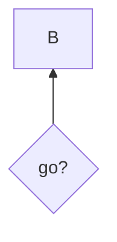

```text
  ┌───┐
  │ B │
  └───┘
    ▲
    │
 ╔══╧══╗
 ║ go? ║
 ╚═════╝
```

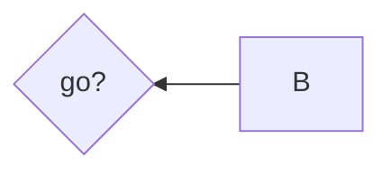

```text
╔═════╗    ┌───┐
║ go? ║◄───┤ B │
╚═════╝    └───┘
```

A `:::` tag glued to a link operator backs off the trailing dashes, keeping
the link (the span classes it assigns are pinned in parse.test.ts).

```mermaid
graph TD
  A:::x-->B
```

```text
 ┌───┐
 │ A │
 └─┬─┘
   │
   ▼
 ┌───┐
 │ B │
 └───┘
```

A multi-rank back edge routes around through the side lane — its endpoint
orders rightmost, so the run to the lane does not cut through `B`.
(Adjacent-rank back edges return locally instead; see back-edges.md.)

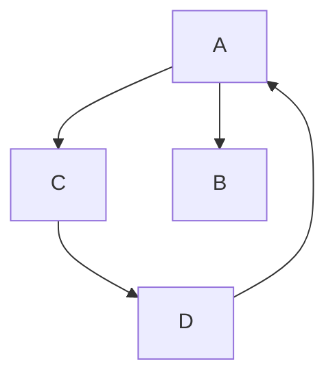

```text
     ┌───┐
     │ A │◄────┐
     └─┬─┘     │
   ┌───┴───┐   │
   ▼       ▼   │
 ┌───┐   ┌───┐ │
 │ C │   │ B │ │
 └─┬─┘   └───┘ │
   │           │
   ▼           │
 ┌───┐         │
 │ D ├─────────┘
 └───┘
```

Kebab-case ids parse as one id: `-` joins when an id char follows, while
`-->`/`-.`/`==` still terminate. Previously `step-1-->step-2` self-looped
on `step`.

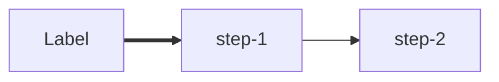

```text
┌───────┐    ┌────────┐    ┌────────┐
│ Label ├━━━▶│ step-1 ├───▶│ step-2 │
└───────┘    └────────┘    └────────┘
```

A quoted stretch inside a `|label|` keeps its pipes as text.

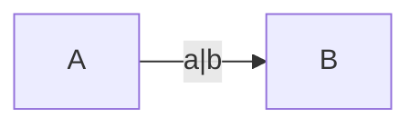

```text
┌───┐ a|b  ┌───┐
│ A ├─────▶│ B │
└───┘      └───┘
```

Arrow and box-drawing characters inside user text survive RL/BT flips —
the glyph remap applies to structure, not authored cells.

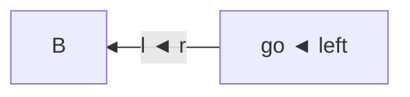

```text
┌───┐  l ◄ r ┌───────────┐
│ B │◄───────┤ go ◄ left │
└───┘        └───────────┘
```

BT restores reading order of multi-row content: wrapped labels read
top-down, not bottom-up.

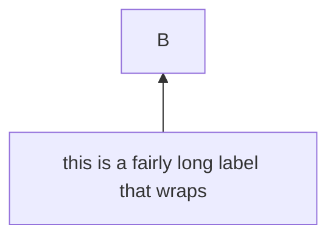

```text
           ┌───┐
           │ B │
           └───┘
             ▲
             │
 ┌───────────┴───────────┐
 │ this is a fairly long │
 │   label that wraps    │
 └───────────────────────┘
```

Parallel edges ride the same cells; their labels join instead of being
silently dropped.

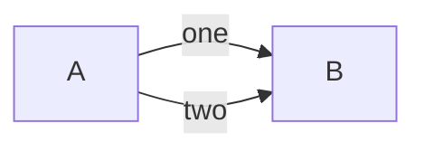

```text
┌───┐ one / two  ┌───┐
│ A ├───────────▶│ B │
└───┘            └───┘
```

The fail-loop shape from the demo: `E -->|fail| C` is an adjacent-rank
back edge and returns locally beside `C --> E`. Previously it climbed the
right lane and its approach cut through `Answer directly`, fabricating
edges that were never written.

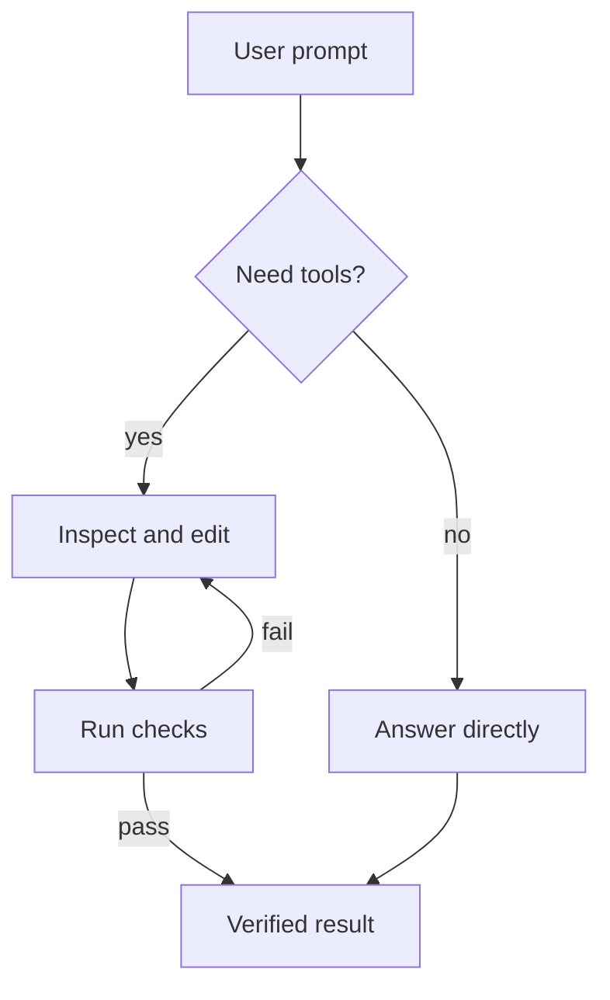

```text
              ┌─────────────┐
              │ User prompt │
              └──────┬──────┘
                     │
                     ▼
              ╔═════════════╗
              ║ Need tools? ║
              ╚══════╤══════╝
          ┌──────────┴───────────┐
          ▼yes                   ▼no
┌──────────────────┐    ┌─────────────────┐
│ Inspect and edit │    │ Answer directly │
└─────────┬────────┘    └────────┬────────┘
          │ ▲fail                │
          │ └──────────┐         │
          └──────────┐ │         └──────────┐
                     ▼ │                    │
              ┌────────┴───┐                │
              │ Run checks │                │
              └──────┬─────┘                │
                     │    ┌─────────────────┘
                 pass▼    ▼
            ┌─────────────────┐
            │ Verified result │
            └─────────────────┘
```

Membership follows mermaid's block claims: a top-level mention never claims
a node, the first closing block that mentions it does (mermaid's own
subgraph docs example — `a2` belongs to `one`, `c1` to `three`).

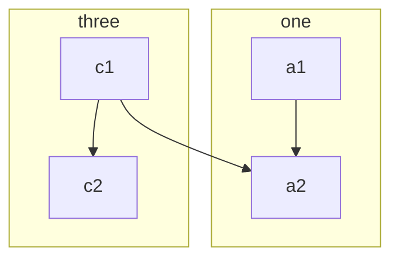

```text
┌ three ─┐
│ ┌────┐ │
│ │ c1 │ │
│ └──┬─┘ │
│    │   │
│    ▼   │
│ ┌────┐ │
│ │ c2 │ │
│ └────┘ │
└────┬───┘
     │
     ▼
┌ one ───┐
│ ┌────┐ │
│ │ a1 │ │
│ └──┬─┘ │
│    │   │
│    ▼   │
│ ┌────┐ │
│ │ a2 │ │
│ └────┘ │
└────────┘
```

Lean bracket shapes drop their slashes from the label, and a double circle
reads whole: `[/x/]` `[\x\]` `[/x\]` `[\x/]` `(((x)))`.

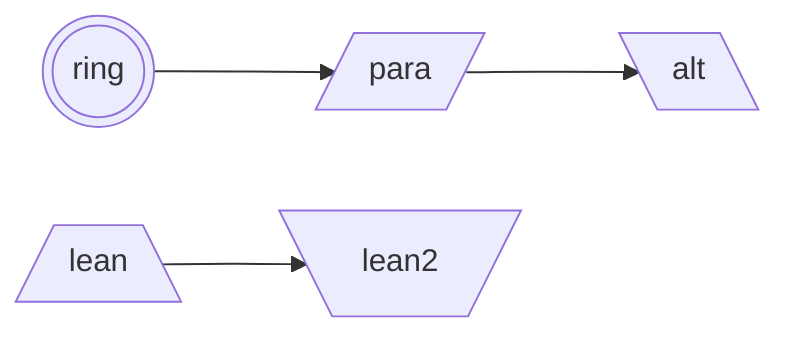

```text
┌──────┐    ┌───────┐
│ lean ├───▶│ lean2 │
└──────┘    └───────┘

╭──────╮    ┌──────┐     ┌─────┐
│ ring ├───▶│ para ├────▶│ alt │
╰──────╯    └──────┘     └─────┘
```

An invisible link `~~~` spaces its nodes without drawing an edge, and a
v11.3 edge id (`e1@`) is skipped rather than costing the statement.

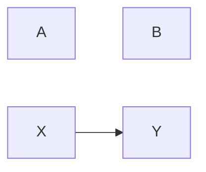

```text
┌───┐
│ A │
└───┘

┌───┐
│ B │
└───┘

┌───┐    ┌───┐
│ X ├───▶│ Y │
└───┘    └───┘
```
