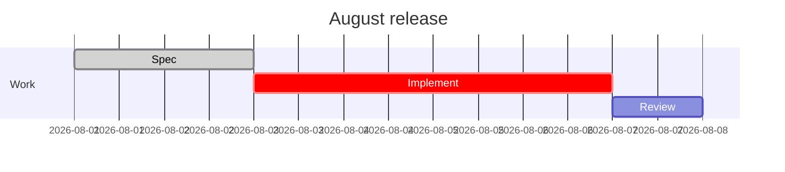
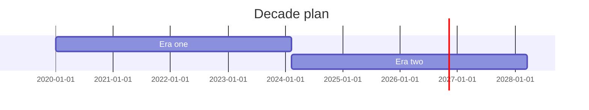

# Gantt charts

Proportional task bars use a natural-width time axis; sections have no track.

```mermaid
gantt
  title Morning release
  dateFormat HH:mm
  section Plan
  Design : done, design, 09:00, 30min
  Build : active, build, after design, 1h
  Gate : milestone, gate, after build
  section Ship
  Publish : after gate, 30min
```

```text
                     Morning release
         09:00                   10:00              11:00
         ┬───────────────────────┬──────────────────────┬
Plan
Design   ────────────····································
Build    ············━━━━━━━━━━━━━━━━━━━━━━━·············
Gate     ···································◆············
Ship
Publish  ···································────────────·
```



```text
                      August release
          Aug 1        Aug 3         Aug 5        Aug 7
          ┬────────────┬─────────────┬────────────┬───────
Work
Spec      ─────────────···································
Implement ·············━━━━━━━━━━━━━━━━━━━━━━━━━━━········
Review    ········································───────·
```

Midnight-crossing clock labels wrap modulo 24 while the timeline stays monotonic.

```mermaid
gantt
  title Night shift
  dateFormat HH:mm
  section Ops
  Watch : w1, 22:30, 2h
  Handover : after w1, 90min
```



```text
                       Night shift
                23:00        00:00         01:00    02:00
         ───────┬────────────┬─────────────┬────────────┬
Ops
Watch    ───────────────────────────·····················
Handover ···························────────────────────·
```

A milestone occupies its start instant, and dependents chain from it.

```mermaid
gantt
  title Gate chain
  dateFormat HH:mm
  Build : b1, 09:00, 1h
  Gate : milestone, g1, after b1, 2h
  Ship : after g1, 30min
```



```text
                       Gate chain
         09:00           09:30          10:00       10:30
         ┬───────────────┬──────────────┬───────────────┬
Build    ───────────────────────────────·················
Gate     ·······························◆················
Ship     ·······························────────────────·
```

Spans beyond the coarsest tick step keep labelled endpoints.



```text
                       Decade plan
         2020-01-01                            2028-03-19
         ┬──────────────────────────────────────────────┬
Era one  ────────────────────────························
Era two  ························───────────────────────·
```

Tasks without a start chain from the previous task's end.

```mermaid
gantt
  title Sequential defaults
  dateFormat HH:mm
  section Flow
  First : 08:00, 30min
  Second : 15min
  Third : 20min
```



```text
                   Sequential defaults
         08:00                 08:30                09:00
         ┬─────────────────────┬────────────────────┬────
Flow
First    ──────────────────────··························
Second   ······················───────────···············
Third    ·································──────────────·
```

A re-declared section starts a new block, keeping authored order.

```mermaid
gantt
  title Repeated sections
  dateFormat HH:mm
  section Prep
  First : 09:00, 30min
  section Cook
  Middle : 09:30, 30min
  section Prep
  Second : 10:00, 30min
```



```text
                    Repeated sections
         09:00           09:30          10:00       10:30
         ┬───────────────┬──────────────┬───────────────┬
Prep
First    ────────────────································
Cook
Middle   ················───────────────·················
Prep
Second   ·······························────────────────·
```
