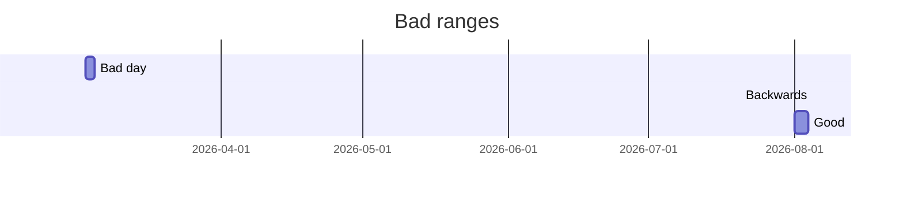

# Broken gantt statements

A bad task line warns without hiding valid tasks.

```mermaid
gantt
  title Lenient parsing
  dateFormat HH:mm
  First : first, 10:00, 1h
  Broken : active, nope
  Later : after first, 1h
```



```text
                     Lenient parsing
         10:00                   11:00              12:00
         ┬───────────────────────┬──────────────────────┬
First    ────────────────────────························
Later    ························───────────────────────·
```

```warnings
dropped, unreadable statement: "Broken : active, nope"
```

Unreadable dates drop with a warning instead of rendering at time zero:
unsupported `dateFormat` values, invalid clocks, overflow-normalized days,
and ranges ending before they start.

```mermaid
gantt
  title Bad dates
  dateFormat DD-MM-YYYY
  Unsupported format : 01-08-2026, 1d
  dateFormat HH:mm
  Bad clock : 25:99, 1h
  Fine : 10:00, 1h
```

```text
                        Bad dates
         10:00                   10:30              11:00
         ┬───────────────────────┬──────────────────────┬
Fine     ───────────────────────────────────────────────·
```

```warnings
dropped, unreadable statement: "Unsupported format : 01-08-2026, 1d"
dropped, unreadable statement: "Bad clock : 25:99, 1h"
```



```text
                       Bad ranges
         Aug 1           Aug 2          Aug 3       Aug 4
         ┬───────────────┬──────────────┬───────────────┬
Good     ───────────────────────────────────────────────·
```

```warnings
dropped, unreadable statement: "Bad day : 2026-02-31, 2d"
dropped, end before start: "Backwards : 2026-08-05, 2026-08-01"
```

Dates parse strictly inside the declared `dateFormat` domain: clock and
calendar timestamps never mix in one chart.

```mermaid
gantt
  title Mixed formats
  dateFormat HH:mm
  Wrong domain : 2026-08-01, 1d
  Right domain : 10:00, 1h
```



```text
                        Mixed formats
             10:00                   10:30              11:00
             ┬───────────────────────┬──────────────────────┬
Right domain ───────────────────────────────────────────────·
```

```warnings
dropped, unreadable statement: "Wrong domain : 2026-08-01, 1d"
```

The timestamp domain is locked once a task has parsed: a mid-chart
`dateFormat` change is ignored with a warning, and tasks written for the
new format drop as unreadable.

```mermaid
gantt
  title Format switch
  dateFormat HH:mm
  Morning : 09:00, 1h
  dateFormat YYYY-MM-DD
  Later : 2026-08-02, 1d
  Also morning : 10:00, 1h
```

```text
                        Format switch
             09:00                   10:00              11:00
             ┬───────────────────────┬──────────────────────┬
Morning      ────────────────────────························
Also morning ························───────────────────────·
```

```warnings
ignored, mid-chart dateFormat change: "dateFormat YYYY-MM-DD"
dropped, unreadable statement: "Later : 2026-08-02, 1d"
```
